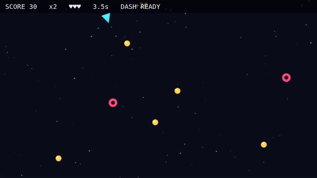
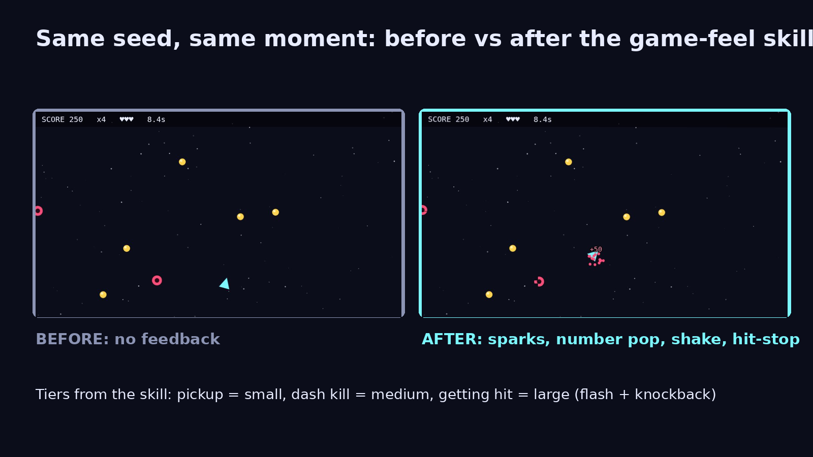
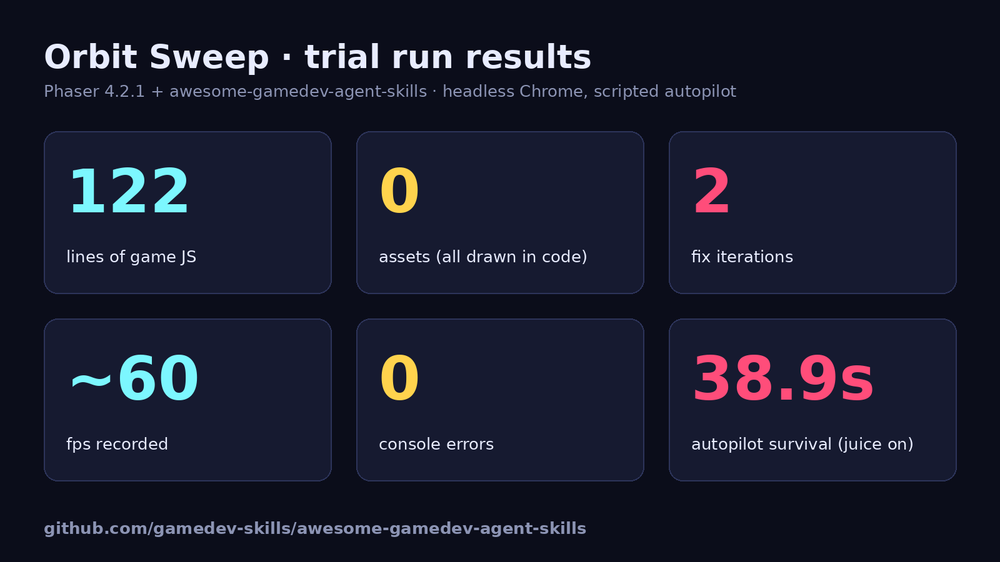

# Orbit Sweep



Orbit Sweep is a small top-down arcade game built with Phaser 4.2.1. You fly a ship, collect gold orbs to build a combo, and press Space to dash through red drones. You have three lives, and drones spawn faster the longer you survive. Everything is drawn in code, with no image files. The game-feel layer (screen shake, hit-stop, squash and stretch, number pops) can be turned off with a URL flag, so you can compare the two versions side by side.

## Features

- Move with WASD or the arrow keys, dash with Space, restart with R
- Combo scoring, a dash that kills drones, three lives, and spawns that speed up over time
- Tiered feedback: small for a pickup, medium for a dash kill, large for getting hit
- Trauma-based camera shake, real-time hit-stop, and squash and stretch with Back easing
- Seeded randomness and a scripted autopilot for repeatable recordings
- Zero image assets: all textures are generated at startup with `Graphics.generateTexture`

## How to run

The whole game is a single static page. Serve the folder over HTTP and open it:

```bash
python3 -m http.server 8000
# then open http://localhost:8000/
```

URL flags:

| Flag | Effect |
|---|---|
| `?juice=0` | turns off the game-feel layer |
| `?auto=1` | the scripted autopilot plays |
| `?seed=N` | sets the random seed (default 7) |

## Tech notes

These are the numbers measured when the game was built:

- 122 lines of game code in a single file (`game.js`)
- In headless Chrome (WebGL via SwiftShader, no GPU): about 60 fps, with 2,268 frames in a 38.9 s autopilot run, none over 25 ms, and 0 console errors
- Autopilot run with the game-feel layer on: survived 38.9 s and scored 1,190 with 22 dash kills. With it off: survived 23.9 s. Hit-stop changes the timing, so these aren't directly comparable scores.

| Before / after | Stats |
|---|---|
|  |  |

More media: [gameplay-juice.mp4](media/gameplay-juice.mp4), [before-after.mp4](media/before-after.mp4)

## Credits

- The code was written by an AI agent following the `phaser-core`, `phaser-arcade-physics` and `game-feel` skills from [awesome-gamedev-agent-skills](https://github.com/gamedev-skills/awesome-gamedev-agent-skills) (a community-made skill collection, Apache-2.0).
- [Phaser](https://phaser.io) 4.2.1 is bundled as `phaser.min.js` under the MIT licence. Its notice is in [licenses/phaser-LICENSE.md](licenses/phaser-LICENSE.md).
